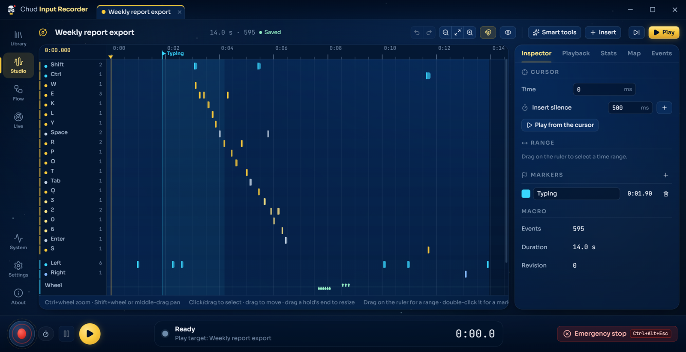
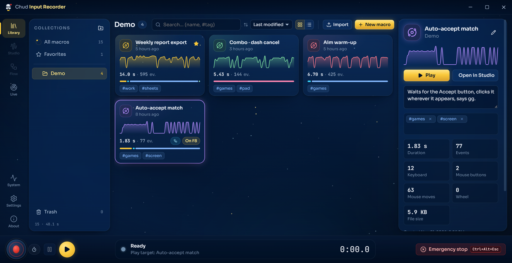
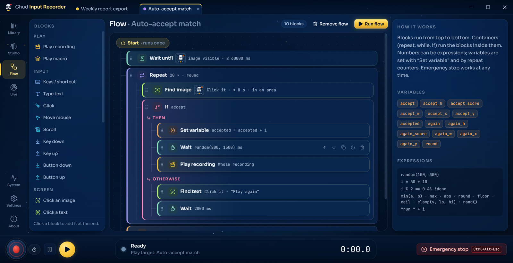
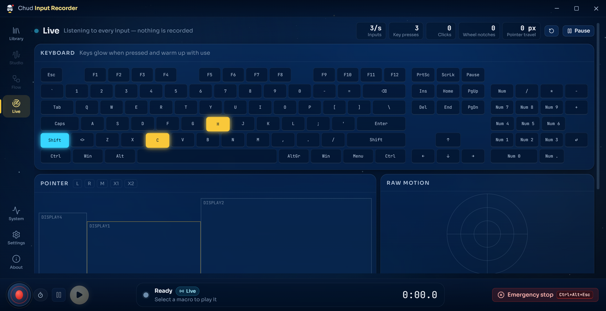

<p align="center">
  
</p>

<h1 align="center">Chud Input Recorder</h1>

<p align="center">
  <b>Record, edit, automate and replay your keyboard, mouse and gamepads.</b><br>
  A macro studio for Windows and Linux that never leaves your computer.
</p>

<p align="center">
  
  
  
  
  
</p>

<p align="center">
  <a href="#-download">Download</a> ·
  <a href="#-quick-start">Quick start</a> ·
  <a href="#-features">Features</a> ·
  <a href="#-privacy-and-safety">Privacy</a> ·
  <a href="#-build-from-source">Build</a> ·
  <a href="#-command-line">CLI</a> ·
  <a href="#-français">Français</a>
</p>

<p align="center">
  
</p>

---

## ✦ Why Chud

Most macro recorders give you a big red button and a list of coordinates. Chud is a full studio around the take:

- **A real timeline.** One lane per key and button, zoom, drag, resize holds, markers, undo and redo. The original take is always kept.
- **Automation without scripts.** Stack visual blocks: repeat, if, wait until, variables, expressions, nested macros.
- **It can see the screen.** Wait for an image, a colour or a piece of text, then click it wherever it appears.
- **Gamepads included.** Record XInput or evdev pads and replay them on a virtual controller.
- **Honest by design.** It works offline, shows when it is recording, has an emergency stop that always works, and never works around the operating system's protections.

## ⬇ Download

Get the latest build from **[Releases](https://github.com/BigFatDeuce/Chud-Input-Recorder/releases/latest)**:

| System | Files |
|---|---|
| Windows 10/11 | a portable `.zip` or `.exe`, nothing to install |
| Linux (preview) | AppImage, `.deb` and `.rpm` |

## ⚡ Quick start

1. Launch Chud and press **F9**, or the red button. If Chud's window is in front, it minimises so it doesn't get in your way. An overlay shows that recording is on.
2. Do what you want to automate, in any application.
3. Press **F9** again. The take lands in the Library and Chud comes back.
4. Select it and press **F8** to play it. **Ctrl+Alt+Esc** stops everything, at any time.

| Default shortcut | Action |
|---|---|
| `F9` | Start / stop recording |
| `F8` | Play the selected macro |
| `F10` | Pause / resume |
| `Ctrl+Alt+Esc` | Emergency stop: halts playback and releases every held key and button |

All of them can be changed in **Settings**.

> [!TIP]
> Chud never records its own window, so clicks and keys inside Chud don't end up in your macro. To try the recorder quickly, press F9 and click around on your desktop.

## ✦ Features

### Library



- Folders, favourites, tags and search by name or `#tag`.
- A trash you can restore from.
- Autosave and a full version history for every macro.
- Each card shows a waveform of the take's activity.
- Every macro is a single open `.chud` file (a ZIP archive, [documented](docs/FORMAT.md)) with a full JSON export and import.
- **Portable mode:** put an empty `portable.flag` next to the executable and everything lives in `./data`.

### Studio: edit the take

- **Timeline**
  - A non-destructive timeline: select, move, delete, resize key holds, insert silences, add markers.
  - Play from the cursor or play only the selection.
- **Inspector and views**
  - The inspector shows the selected events.
  - An event list, a pointer-path map and statistics.
- **Smart tools**
  - Remove dead time and simplify mouse paths.
  - Merge wheel notches and raw motion.
  - Fix stuck or orphan keys and make the timing uniform.
  - Detect repetitions and extract a range into a new macro.
- **Playback**
  - Speed and repeat count.
  - Timing modes: exact, relative, adaptive, fast or custom.
  - Absolute, relative or no mouse.
  - Physical or logical keys.
  - Coordinates adapted to a different screen layout.

### Flow: automate it



**Blocks**

| Group | Blocks |
|---|---|
| Play | play the recording, or play another macro |
| Input | keys and shortcuts, type text, click, smooth or human-like mouse moves, scroll, key and button down/up |
| Screen | wait until, find an image, a colour or text, then click it, move to it, or just remember where it is |
| Logic | repeat, while, if / otherwise, set variable, wait, notify, break, continue, stop |

**Conditions** can test:
- an expression;
- the active window, or whether a window exists;
- a pixel's colour, or something visible on screen;
- whether a key is held;
- a random chance.

Combine them with not, all and any.

**Expressions** are safe, sandboxed and checked as you type, for example `random(800, 1500)`, `i % 2 == 0 && !done` or `"run " + i`.

**Built-in screen picker**
- Freezes the screen and gives you zoom and a pixel loupe on every monitor.
- **Test now** runs a search before you run the whole flow.

### Live: see every input



- **Keyboard heat map.** Keys glow while you hold them and warm up with use.
- **Pointer view.** Your pointer, drawn across every monitor.
- **Raw motion.** Movement from games that lock the cursor.
- **Gamepad view and counters.**

Live never records anything. It is perfect for checking that Chud sees your devices.

### Recording options

- **What to capture:** keyboard, mouse buttons, wheel and absolute pointer positions, raw sensor motion, and gamepads.
- **When to start:** a countdown with optional soft beeps, or start on your first input instead of the shortcut.
- **Limits:** maximum length, key filter, and a single-application mode.
- **Always visible:** a discreet indicator while recording (overlay, tray icon and timer).

### Interface

- A dark "spatial" interface in **English and French**.
- Interface size from 80 to 150 % (`Ctrl+=`, `Ctrl+-`, `Ctrl+0`).
- The window always stays reachable, whatever your screen layout.
- **System** diagnostics explain what works on your machine and why.

## ✦ Platform support

| | Windows 10/11 | Linux X11 | Linux Wayland |
|---|:---:|:---:|:---:|
| Keyboard, mouse buttons, wheel | ✔ | ✔ | ✔ |
| Absolute pointer positions | ✔ | ✔ | relative motion only |
| Application exclusions | ✔ | ✔ | not possible |
| Gamepad capture | XInput pads | ✔ | ✔ |
| Gamepad playback | with [ViGEmBus](https://github.com/nefarius/ViGEmBus) | ✔ uinput | ✔ uinput |
| Find an image or colour on screen | ✔ | ✔ | not possible¹ |
| Find text on screen (OCR) | ✔ built-in Windows OCR | not yet | not yet |
| Swallow global shortcuts | ✔ | the focused app sees them too | the focused app sees them too |

¹ Only the compositor can read the screen on Wayland.

The honest, per-feature status, including what is still missing, is in **[docs/ROADMAP.md](docs/ROADMAP.md)**.

## 🔒 Privacy and safety

- **Nothing leaves your computer**
  - No network connections, no accounts, no telemetry.
  - Fonts are bundled, so the app works fully offline.
- **Recording is always visible**: an overlay, the tray icon, the window title and a timer.
- **Excluded applications**
  - Password managers and Windows credential prompts are excluded by default, and you can add your own.
  - Nothing is recorded while an excluded application is in front.
- **Emergency stop**: a global shortcut that works even if the interface is frozen.
- **Held keys are released**: every key, button and gamepad input that playback holds is let go on stop, pause or error.
- **Screen captures stay in memory**
  - Captures used for searching are never written to disk.
  - Only the pictures you pick are stored in the macro.
- **System protections are explained, never bypassed**: Chud does not work around UIPI (elevated windows), Wayland's restrictions or the injected-input flag that anti-cheat systems can see.

## 🛠 Build from source

Requirements:
- [Rust](https://rustup.rs) 1.88 or newer.
- [Node.js](https://nodejs.org) 20 or newer.
- The [Tauri 2 prerequisites](https://v2.tauri.app/start/prerequisites/) for your system:

| System | Prerequisites |
|---|---|
| Windows | MSVC build tools, and WebView2 (it ships with Windows 11) |
| Fedora | `sudo dnf install webkit2gtk4.1-devel gtk3-devel libsoup3-devel librsvg2-devel openssl-devel` |
| Debian / Ubuntu | `sudo apt install libwebkit2gtk-4.1-dev libgtk-3-dev libsoup-3.0-dev librsvg2-dev libssl-dev build-essential` |

```sh
cd app
npm install
npx tauri dev                 # run in development mode
npx tauri build --no-bundle   # optimised executable in target/release
npx tauri build               # installers: MSI/NSIS on Windows, deb/rpm/AppImage on Linux
```

Checks:

```sh
cargo test --workspace
cargo clippy --workspace --all-targets
cd app && npx tsc --noEmit && npx vitest run
```

### Linux permissions

Chud reads input straight from the kernel (evdev), so your user must be in the `input` group. Keep in mind that any program you run can then read the keyboard too.

```sh
sudo usermod -aG input $USER     # then log out and back in
```

Playback through uinput (Wayland and gamepads) needs write access to `/dev/uinput`. The **System** page shows the exact udev rule to add. Chud never changes permissions by itself.

## ⌨ Command line

```text
chud info <file.chud>                  describe a macro
chud play <file.chud> [--speed X] [--repeat N] [--mouse absolute|relative|off]
chud record <out.chud> [--seconds N]   record (F9 also stops)
chud export <file.chud> <out.json>     full JSON export
chud diag checks | timer | loopback | gamepad
chud screen capture <out.png> [--region x,y,w,h]
chud screen find <image.png> [--threshold 0.9] [--any-scale] [--all] [--region x,y,w,h]
chud screen text [words] [--region x,y,w,h]
```

Build it with `cargo build -p chud-cli --release`.

## 🧭 Project layout

```text
crates/chud-core      events, timeline and history, editing tools, .chud format,
                      playback plan, Flow (blocks + expressions), image search. No system APIs.
crates/chud-platform  system back-ends: Windows (hooks, SendInput, XInput, ViGEm, screen, OCR)
                      and Linux (evdev, uinput, X11)
crates/chud-engine    state machine, recorder, player, shortcuts, Flow runtime, safety
crates/chud-cli       the `chud` command line
app/                  the desktop app: Tauri 2 + React 19 + TypeScript
```

These documents are in French:
- [docs/ARCHITECTURE.md](docs/ARCHITECTURE.md): the technical design.
- [docs/FORMAT.md](docs/FORMAT.md): the `.chud` file format and the Flow JSON.
- [docs/ROADMAP.md](docs/ROADMAP.md): what is done, what is verified, and what is still missing.

## License

[MIT](LICENSE).

---

## 🇫🇷 Français

**Chud Input Recorder** enregistre, édite, automatise et rejoue le clavier, la souris et les manettes, sous Windows et Linux, entièrement hors ligne.

### Démarrage rapide

1. Lancez Chud et appuyez sur **F9**, ou sur le bouton rouge. Si Chud est au premier plan, il se réduit pour ne pas gêner. Un indicateur signale l'enregistrement.
2. Faites ce que vous voulez automatiser, dans n'importe quelle application.
3. Appuyez de nouveau sur **F9** : la prise arrive dans la Bibliothèque.
4. Sélectionnez-la et appuyez sur **F8** pour la rejouer. **Ctrl+Alt+Échap** arrête tout, à tout moment.

> [!TIP]
> Chud n'enregistre jamais sa propre fenêtre : les clics et touches faits dans Chud ne finissent pas dans la macro.

### Fonctions

- **Bibliothèque**
  - Dossiers, favoris, étiquettes, recherche et corbeille.
  - Sauvegarde automatique et historique des versions.
  - Mode portable et format ouvert `.chud`, avec export JSON complet.
- **Studio**
  - Une timeline non destructive, une piste par touche ou bouton, annuler/rétablir, marqueurs.
  - Des outils de nettoyage : temps morts, trajectoires, touches bloquées, répétitions.
- **Lecture**
  - Vitesse, répétitions et cinq modes de timing.
  - Souris absolue ou relative, touches physiques ou logiques.
  - Adaptation à un autre écran et manettes virtuelles.
- **Flow**
  - L'automatisation par blocs : boucles, conditions, variables, expressions et macros imbriquées.
  - La **recherche à l'écran** trouve une image, une couleur ou un texte, puis clique dessus, l'attend ou s'en sert comme condition.
- **Direct** : chaque touche, clic, mouvement et manette, en temps réel, sans rien enregistrer.

### Vie privée et sécurité

- Aucune donnée n'est envoyée sur le réseau, et il n'y a aucune télémétrie.
- L'enregistrement est toujours signalé.
- Les gestionnaires de mots de passe sont exclus par défaut, et vous pouvez exclure d'autres applications.
- L'arrêt d'urgence est disponible à tout moment, et les touches maintenues sont relâchées à l'arrêt.
- Les protections du système sont expliquées, jamais contournées.

### Compiler

Il faut Rust 1.88+, Node.js 20+ et les prérequis de Tauri 2 (voir [Build from source](#-build-from-source)), puis :

```sh
cd app
npm install
npx tauri dev
```

### Documentation

- [Architecture](docs/ARCHITECTURE.md)
- [Format de fichier](docs/FORMAT.md)
- [État réel des fonctionnalités](docs/ROADMAP.md) : ce qui est fait, ce qui est vérifié et ce qui manque encore.
